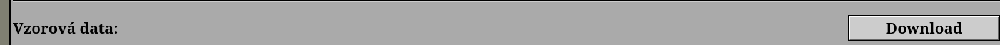

<div align="center">

# progtester

**A local Progtest simulator that tries to break your program.**


[🇨🇿 Čeština](README.md) · 🇬🇧 English

</div>

---

progtester compiles your solution the same way Progtest does, runs the sample data from the
assignment, and then tries to break it with thousands of derived inputs: boundary values, invalid
input, truncated input, huge inputs and random mutations. It looks for crashes, memory errors,
undefined behaviour and algorithms that are too slow, and it also grades how readable the code is.

The tester **does not know the solution to any task**. For inputs without a known expected output it
only checks things that must always hold (the program does not crash, does not write out of bounds,
the output has the right shape, …).

## Contents

- [Quick start](#quick-start)
- [What the tester does](#what-the-tester-does)
- [Reading the results](#reading-the-results)
- [Compilation](#compilation)
- [Sample data](#sample-data)
- [Breaking tests](#breaking-tests)
- [Memory errors: ASan, UBSan and valgrind](#memory-errors-asan-ubsan-and-valgrind)
- ["Write a function" tasks](#write-a-function-tasks)
- [Code style](#code-style)
- [Time complexity estimate](#time-complexity-estimate)
- [Custom tests and generators](#custom-tests-and-generators)
- [Options](#options)
- [Developing the tester](#developing-the-tester)

## Quick start

You need Linux (WSL on Windows), `python3` ≥ 3.10 and `g++`. Nothing else gets installed.
Optional: `valgrind` for `--valgrind`, `cppcheck` and `clang-tidy` for a more detailed code check
(`sudo apt install valgrind cppcheck clang-tidy`).

```sh
git clone https://github.com/th3ch0s3n1/progtester.git
```

Put the `progtester` folder next to your task folders. Each task has its own folder with the source
code and the sample data:

```
.
├── progtester/
├── 01_task/
│   ├── main.c            ← your solution
│   └── sample/           ← sample data from Progtest
│       ├── CZE/
│       └── ENG/
└── 02_another_task/
    └── ...
```

Download the sample data on the task's page in Progtest with the **Download** button on the
"Sample data" row and extract it into `sample/`:



Then run the tester:

```sh
python3 progtester/progtest.py 01_task                    # everything
python3 progtester/progtest.py 01_task --only-samples     # sample data only, fast
python3 progtester/progtest.py 01_task --valgrind         # also check under valgrind
python3 progtester/progtest.py 01_task --only-complexity  # complexity estimate only
```

If the folder contains more than one source file, the tester picks `program.c`, `main.c`,
`program.cpp` or `main.cpp`; otherwise choose one with `--src`. You can also pass the path to a
source file instead of a folder.

## What the tester does

One run goes through these steps:

1. **[Compilation](#compilation)** with the same flags as Progtest, plus a check for forbidden functions.
2. **[Code style](#code-style)**: function length and complexity, global variables, magic numbers, …
   and a grade from 1 to 5.
3. **[Sample data](#sample-data)**: the output is compared with the sample byte by byte.
4. **[Breaking tests](#breaking-tests)**: inputs derived from the samples. Every input runs in
   several builds (`-O2`, ASan/UBSan, optionally valgrind) so that
   [memory errors](#memory-errors-asan-ubsan-and-valgrind) show up too.
5. **[Time complexity estimate](#time-complexity-estimate)**: the tester enlarges the sample inputs,
   measures the time and estimates whether the program meets the limit on large data too.

For ["write a function" tasks](#write-a-function-tasks), where you submit only a function, the test
`main()` from the assignment runs instead of steps 3–5.

## Reading the results

Every test ends as **OK**, **WARN** or **FAIL**:

- **FAIL** is an error that would most likely fail the test on Progtest: wrong output, crash,
  timeout, memory error, undefined behaviour.
- **WARN** is suspicious but not necessarily wrong: an unknown line in the output, output on stderr,
  a run taking more than half of the time limit.

At the end there is a summary for each set of sample data and the grades for style and complexity.
Each group of tests lists its first three problems (`--show N` shows more), including a diff against
the expected output:

```
FAIL Zakladni test (vzorova data): 1/4 OK, 3 chyb
   FAIL sample/CZE/0000_in.txt
        vstup:  1 2 3\n
        vystup: Zadejte cisla:\nSoucet: 1\nSoucet: 3\nSoucet: 6\nNespravny vstup.\n
        - vystup neodpovida ocekavanemu
          vse spravne, jen na konci navic chybova hlaska -> program bere konec vstupu (EOF) jako chybu. ...
          --- ocekavano
          +++ dostal
          @@ -3,2 +3,3 @@
           Soucet: 3\n
           Soucet: 6\n
          +Nespravny vstup.\n
        ulozeno: 0001_fail_*.txt
```

The tester's messages are in Czech (without diacritics). In this example the output is correct
except for an extra error message at the end: the program treats the end of input (EOF) as invalid
input.

All problematic inputs are saved to `progtester/vysledky/<task>/` (elsewhere with `--out`):

| File | Contents |
|---|---|
| `0001_fail_in.txt` | input |
| `0001_fail_out.txt` | output of your program |
| `0001_fail_ref.txt` | expected output, if known |
| `0001_fail_info.txt` | what went wrong |

To reproduce the failure with your own build: `./a.out < progtester/vysledky/01_task/0001_fail_in.txt`.

The tester exits with `0` when nothing failed (warnings are fine), `1` on any FAIL, and `2` when the
program does not compile or uses forbidden functions.

## Compilation

The program is compiled as on Progtest:

```
g++ -std=c++20 -Wall -pedantic -D__PROGTEST__ -O2 -Wextra main.c -o prog -lm
```

- Progtest compiles `.c` files with `g++` too, that is as C++. Code that is valid C but not valid C++
  (e.g. `int *p = malloc(...)` without a cast) therefore fails here as well. `--cc gcc` compiles `.c`
  as C (`gcc -std=c11`).
- `--strict` adds `-Werror`.
- The program must not call `system`, `fork`, `exec*`, `popen`, sockets and the like, otherwise
  Progtest will not run it. If you need them for debugging, wrap them in `#ifndef __PROGTEST__ … #endif`.

Besides this build, the program is also compiled with `-O0 -fsanitize=address,undefined`, and with
`--valgrind` also with `-O0 -g`; see [memory errors](#memory-errors-asan-ubsan-and-valgrind).

## Sample data

All `*_in.txt` / `*_out.txt` pairs from the `sample/` folder (including subfolders) and from
[`tests/`](#custom-tests-and-generators) are tested. Of the `CZE` and `ENG` folders only `CZE` is
used; choose another language with `--lang ENG` or `--lang all`. `*_out_win.txt` files are ignored.

The output is compared exactly, byte by byte. The program reads its input from a file, so it always
reaches the end of input (EOF). When a program treats EOF as invalid input and prints an extra error
message at the end, the tester points this out separately. When trying the program by hand in a
terminal, send EOF with **Ctrl+D**.

Some tasks split the sample data into sets, e.g. `sample/basic/` (mandatory tests) and
`sample/extra/` (an optional test with large inputs). The tester evaluates each set separately:

```
== Shrnuti
   FAIL Zakladni test (vzorova data): 4/8
   FAIL Nepovinny test (vzorova data extra): 0/11
```

`bonus*` subfolders are reported as bonus tests. `--suite basic` tests only the chosen set (the
option can be repeated).

## Breaking tests

From every sample input the tester derives more:

| Group | What is tried |
|---|---|
| Whitespace | missing or extra `\n`, spaces at the start and end of lines |
| Boundary values | numbers in the input replaced with `0`, `-0`, `INT_MAX`, `INT_MAX+1`, `000N`, `+N`, 40 nines, … |
| Decimal numbers | only for tasks with decimal numbers, see below |
| Invalid input | `abc`, `1abc`, `1.23`, `0x1`, empty input, `\0`, UTF-8, `\r\n`, … |
| Truncated input | input cut off in the middle, at every position |
| Large inputs | 1 MB of spaces, zeros or random bytes, 100,000 digits, the sample 50,000× in a row |
| Fuzz | random mutations of the samples (`--fuzz N`, reproducible with `--seed`) |

**Decimal numbers.** When a sample input contains decimal numbers, the tester multiplies all of them
by `1e±6` up to `1e±300`. The output may then change only in that its numbers are rescaled the same
way. This catches comparisons with a fixed epsilon and printing with `%.2f`. Tasks where this does
not hold (multiplication, division) are detected by a control run and the test is skipped. The tester
also tries other spellings of the same number (`1.5` → `1.50`, `15e-1`, `0.15e1`), which must not
change the output at all.

Most of these inputs have no known output. For them the tester checks:

| Level | Check |
|:---:|---|
| FAIL | crash (SIGSEGV, …), timeout, memory limit exceeded, output over 16 MB |
| FAIL | ASan/UBSan: out-of-bounds access, `int` overflow, memory leak, … |
| FAIL | the `-O2` and `-O0` builds print something different (undefined behaviour) |
| FAIL | empty output, missing `\n` at the end, `\r` in the output, missing prompt (the first line shared by all samples) |
| WARN | a line that appears in no sample output, even with numbers treated as arbitrary; the tester suggests the most similar sample line (usually a typo) |
| WARN | output on stderr, a run taking more than half of the time limit |
| WARN | for whitespace and number spelling variants: the output differs from the sample |

> [!NOTE]
> The tester does not decide whether the program should print an error message or a result for a
> given input. That would require knowing the solution. If you have a reference program (for example
> your own previously accepted solution), pass it with `--ref ./binary` and all outputs are compared
> with it exactly.

## Memory errors: ASan, UBSan and valgrind

Every input also runs in a build with **AddressSanitizer and UndefinedBehaviorSanitizer**. They find
out-of-bounds access, use of freed memory, memory leaks and integer overflow, and show the line in
the code.

Sanitizers do not detect reads of **uninitialized memory**. A typical symptom is that the `-O2` and
`-O0` outputs differ, or that the program behaves differently on Progtest than at home. Valgrind
finds it: `--valgrind` runs the sample data and a random selection of smaller generated inputs under
valgrind, at most 300 in total (`--valgrind 50` at most 50). Valgrind is about 50× slower, so it does
not run on everything.

```
   FAIL sample/CZE/0000_in.txt
        - [valgrind] Use of uninitialised value of size 8
            at _itoa_word (_fitoa_word.c:38)
            ...
            by printf (printf.c:33)
            by main (uninit.c:13)
          Uninitialised value was created by a heap allocation
            at malloc (vg_replace_malloc.c:447)
            by main (uninit.c:7)
```

## "Write a function" tasks

In some tasks you submit only a function, and the assignment contains a test `main()` with asserts:

```c
#ifndef __PROGTEST__
#include <stdio.h>
#include <assert.h>
#endif /* __PROGTEST__ */

int dateToIndex(int day, int month, int year, int *idx) { /* your solution */ }

#ifndef __PROGTEST__
int main(void)
{
    int idx;
    assert(dateToIndex(1, 1, 2000, &idx) == 1 && idx == 1);
    ...
}
#endif /* __PROGTEST__ */
```

The tester recognizes such a task because no `main()` is left in the code with `-D__PROGTEST__`. It then:

1. Compiles the code the way Progtest does, that is with `-D__PROGTEST__` and with the headers from
   the `#ifndef __PROGTEST__` blocks, which Progtest supplies itself. It reports functions that your
   solution calls but that are defined only in the test part, so they would be missing on Progtest.
2. Runs the test `main()` in the `-O2` build, under ASan/UBSan and under valgrind (if installed).
   It uses its own [`assert`](pt/include/assert.h), which keeps going after a failure, prints the
   values of both sides of a comparison, and on a crash or an infinite loop tells you which assert
   it happened in.

```
== Testy z main() v #ifndef __PROGTEST__ (asserty ze zadani)
   FAIL [-O2] selhalo 3 assertu z 10
        r. 31: assert(absVal(-5) == 5)
               hodnoty: -5 == 5
        r. 32: assert(absVal(-7) == 7 && idx == 3)
               hodnoty: -7 == 7
        r. 37: assert(third() == 0.3)
               hodnoty: 0.30000000000000004 == 0.3
    OK  ASan/UBSan: bez chyb, asserty dopadly stejne jako v -O2
    OK  valgrind: bez chyb, asserty dopadly stejne jako v -O2
```

Values are printed for numbers, characters, strings (`char *` and `std::string`), pointers and
anything that can be printed with `operator<<`; for `&&` only the first part that does not hold.
With `--cc gcc` asserts are only counted, without values. An assert that cannot be decomposed
(e.g. `assert(x = f())`) is evaluated by the standard `assert`, and the program stops at the first
failure.

## Code style

The tester goes through the code and grades it by the rules in the table. The grade is a guide only:
the rules follow common recommendations for readable C/C++ code, they are not the official criteria
of Progtest or of the teaching assistants.

| What | Rule |
|---|---|
| function length | at most 50 lines of code (over 100 is a major issue) |
| branching (`if`, `for`, `while`, `case`, `&&`, `\|\|`, `?`) | at most 10 paths through the code (over 20 is a major issue) |
| block nesting | at most 3 levels (over 5 is a major issue) |
| function parameters | at most 5 |
| the whole program in `main` | severe issue |
| comments | at least half of the longer functions (except `main`) have a comment |
| global variables, `goto` | do not use (constants via `const` or `#define` are fine) |
| magic numbers | more than 5 different numbers other than 0, 1, 2, 10 and 100 → give them names |
| duplicate code | 5 or more identical lines in two places → move them into a function |
| naming | do not mix `snake_case` and `camelCase` |
| formatting | do not mix tabs and spaces, lines at most 120 characters |

The test part in `#ifndef __PROGTEST__ … #endif` is not checked.

If **cppcheck** or **clang-tidy** is installed, their findings are added. Findings that point to a
bug rather than to style (`error`/`warning` from cppcheck, `bugprone-*` from clang-tidy, e.g. an
uninitialized variable or a memory leak on `realloc`) are listed separately and do not count towards
the grade.

```
   funkce                           radku  vetveni  zanoreni  param  komentar
   operations_handler                  49       18         2      2  ano
   ...
   Pravdepodobne chyby (staticka analyza):
   WARN r. 110: [cppcheck error] Uninitialized variable: start_time.total_minutes
   WARN r. 464: [clang-tidy] 'a->array' may be set to null if 'realloc' fails, ... (bugprone-suspicious-realloc-usage)

   Styl:
    - odsazeni micha tabulatory a mezery
    - r. 83: funkce operations_handler ma 18 cest kodem (...; doporuceno nejvys 10) - vyclen casti do pomocnych funkci

   -> znamka 3: dobre - stoji za to uklidit (12 trestnych bodu, 3.6 na 100 radku kodu)
```

**How the grade is computed:** a minor finding costs 1 penalty point, a major one 2, and the whole
program in `main` 6. The same kind of finding counts at most three times. The points are scaled to
100 lines of code (a shorter program counts as 100 lines): up to 1 point is grade **1**, up to 2.5
**2**, up to 4.5 **3**, up to 7 **4**, more **5**.

## Time complexity estimate

Finally the tester estimates how fast the running time grows with the input size. It does not know
the task, so it starts from the sample inputs and tries to enlarge them in generic ways. Using the
sample line `1 2 3` as an example:

| Way of enlarging | Example | Ideal |
|---|---|:---:|
| line n times | `1 2 3` n times, one below another | O(n log n) |
| line n times, number +1 | `1 2 3`, `1 2 4`, `1 2 5`, … | O(n log n) |
| element n times | `1 1 1 … 1 2 3` | O(n log n) |
| whole input n times | the whole sample input n times in a row | O(n log n) |
| number + n | `1 2 [3 + n]` | O(log n) |

An enlarged input counts only as long as the program accepts it: it must not crash or print an error
message, and the number of answers must grow with n. This way the program itself defines how large
inputs make sense. All ways are first measured roughly, and the ones that slow the program down most
are then measured precisely (`--complexity-max`, default 6). The measured times are fitted with the
models O(1), O(log n), O(n), O(n log n), O(n²) and O(n³):

```
   radek '1 2 3' n-krat  (sample/CZE/0000_in.txt:1)  (idealne O(n log n))
                n     CPU cas      vstup
                1      2.4 ms       0 kB
               64      5.3 ms       0 kB
            2 048      9.9 ms      12 kB
            8 192     68.0 ms      48 kB
           32 768    946.4 ms     192 kB
   -> namereno O(n^2), lokalni exponent n^1.89
   -> limit 1 s by se prekrocil od n ~ 32 768
   -> znamka 4: cas roste s poctem prvku jako O(n^2) a program takovy vstup prijima - pri vetsim n nestihne limit (idealne O(n log n))
```

| Grade | Meaning |
|:---:|---|
| 1 | the complexity matches the ideal and meets the limit |
| 2 | worse than ideal, but meets the limit on the inputs the program accepts |
| 3 | one class worse than ideal, or a good complexity with too large a constant |
| 4 | worse than ideal and misses the limit, or a suspicious jump in time |
| 5 | orders of magnitude too slow |

If the program crashes while the input grows, the tester reports it and saves the input to
`vysledky/`. It also retries without the memory limit to show whether the program just needs a lot
of memory or does not check for `NULL` from `malloc`. A sudden jump in time (flat for a long while,
then a steep rise) usually means a variable overflow or an infinite loop.

> [!NOTE]
> This is an estimate, not a proof. The tester can only enlarge what it sees in the sample data.
> O(n) and O(n log n) are hard to tell apart by measurement, so in that case the tester lists both.

## Custom tests and generators

**Custom tests:** `NNNN_in.txt` and `NNNN_out.txt` files in `<task>/tests/` are tested just like the
sample data. Their outputs also extend the set of lines the tester considers known.

**Custom generator for the complexity estimate:** when you want to measure a specific parameter, put
a `complexity.py` file in the task folder (or pass it with `--complexity FILE`). The tester then uses
it instead of enlarging the samples automatically:

```python
TIME_LIMIT = 1.0   # [s] optional, otherwise --timeout

def gen(n):        # returns a VALID input of size n (str or bytes)
    return f"{n}\n" + " ".join(map(str, range(n))) + "\n"

SERIES = [dict(name="number of elements", gen=gen, n_min=16, n_max=1_000_000, target="n log n")]
```

`n_min` is the first size measured (it doubles from there), `n_max` the largest `n` that can come up
on Progtest (the time is extrapolated to it), and `target` the complexity of a good solution: `1`,
`log n`, `n`, `n log n`, `n^2` or `n^3`.

## Options

| Option | Default | Description |
|---|:---:|---|
| **What to test** | | |
| `--only-samples` | | sample data only |
| `--only-style` | | compilation and code style only |
| `--only-complexity` | | complexity estimate only |
| `--no-style` | | skip the code style check |
| `--no-complexity` | | skip the complexity estimate |
| `--no-asan` | | skip the ASan/UBSan build |
| `--no-big` | | skip large inputs |
| `--valgrind [N]` | | also run valgrind on at most N inputs (300 without a number) |
| `--suite SET` | | only the chosen set of sample data (`basic`, `extra`, `bonus…`, `tests`); can be repeated |
| `--lang CZE\|ENG\|all` | `CZE` | language of the sample data |
| `--fuzz N` | `200` | number of random inputs |
| `--seed N` | `1` | seed for random inputs |
| `--ref BIN` | | reference program all outputs are compared with |
| **Limits** | | |
| `--timeout S` | `1` | time limit per run in seconds |
| `--mem MB` | `256` | memory limit for the `-O2` build |
| **Compilation** | | |
| `--src FILE` | | source file, when the folder has more than one |
| `--cc g++\|gcc` | `g++` | compiler; `gcc` compiles `.c` as C |
| `--strict` | | compile with `-Werror` |
| **Complexity estimate** | | |
| `--complexity FILE` | `<task>/complexity.py` | custom input generator |
| `--complexity-max N` | `6` | how many of the worst ways of enlarging to measure precisely |
| **Output** | | |
| `--show N` | `3` | how many problems to show in detail per group |
| `--out DIR` | `vysledky/<task>` | where to save problematic inputs; emptied at the start, refuses an existing non-empty directory the tester did not create |
| `-j N` | number of cores | how many tests to run in parallel |

## Developing the tester

The tester has its own tests in [tests/](tests/): unit tests of the individual parts and end-to-end
tests that run the whole tester on small programs with a known bug ([tests/fixtures/](tests/fixtures/)).

```sh
python3 -m unittest discover -s tests            # everything (~1 min)
PT_FAST=1 python3 -m unittest discover -s tests  # without the complexity estimate (~25 s)
```

Run them especially after changing the heuristics (complexity estimate, code style, input
generation). These parts can break without it being obvious at first sight.
